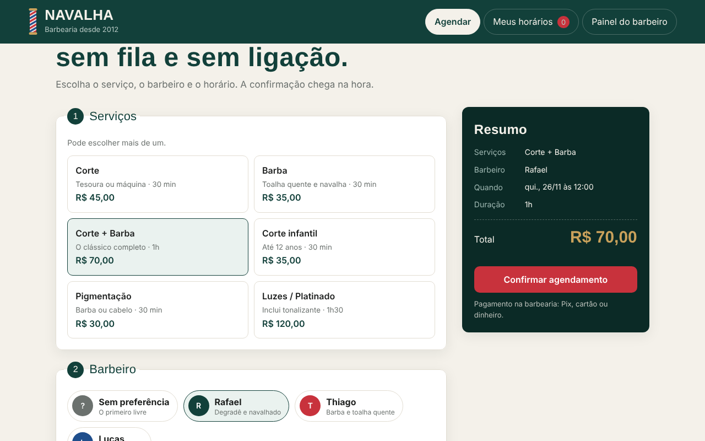

# Navalha Barbearia — Sistema de agendamento

Sistema de agendamento online para barbearias: o cliente escolhe os serviços, o barbeiro, o dia e um horário livre, e confirma em poucos cliques.

## Funcionalidades

- **Vários serviços no mesmo horário:** soma o tempo e o preço automaticamente.
- **Escolha do barbeiro** ou "sem preferência" (o sistema escolhe o primeiro livre).
- **Horários livres de verdade:** bloqueia horários ocupados, passados e os que não cabem na duração do serviço.
- **Domingo fechado** e agenda dos próximos 14 dias.
- **Confirmação com código** e botão para avisar a barbearia pelo WhatsApp com a mensagem pronta.
- **Meus horários:** lista de agendamentos com cancelamento.
- **Painel do barbeiro:** agenda do dia por profissional, faturamento previsto e taxa de ocupação.
- Máscara de telefone, validação de formulário e layout responsivo (celular e desktop).

## Como rodar

Não precisa instalar nada. Baixe o projeto e abra o `index.html` no navegador.

Para publicar, envie a pasta para a **Netlify** (arraste e solte) ou ative o **GitHub Pages** em *Settings → Pages*.

## Personalizar

- **WhatsApp:** troque o número na constante do início do `js/script.js` (formato `5551999999999`).
- **Serviços, preços e equipe:** ficam em listas no topo do `js/script.js`.
- **Cores:** variáveis CSS no início do `css/style.css`.

## Tecnologias

HTML5 · CSS3 (Grid, Flexbox, variáveis, `:has()`) · JavaScript puro (sem frameworks) · `localStorage`

---
Feito por **Vinicius Lima** · [viniciuslimadev.netlify.app](https://viniciuslimadev.netlify.app)
